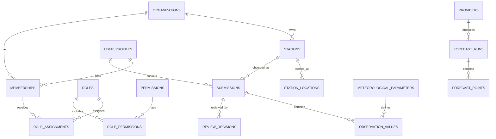

# METRA Weather Intelligence — Fresh Database Architecture

**Status:** Architecture proposal for review; not applied to any database  
**Branch:** `work/database-architecture-fresh-design-2026-11-14`  
**Decision:** Greenfield domain model. No legacy schema cloning and no legacy data migration.  
**Target:** Flutter client, trusted .NET application API, PostgreSQL on the dedicated new METRA Supabase project; Supabase Auth may provide identity, while authorization and domain transactions remain server-enforced.

## 1. Foundational decision

This database is designed from the requirements of METRA Weather Intelligence as a new meteorological application. The former METRA database, its tables, column names, constraints, migration history, and rows are **not** the design template.

- No legacy rows are imported, copied, synchronized, or transformed.
- No old table is retained merely for compatibility.
- Existing legacy SQL is not treated as an authoritative specification for the new product.
- The old database is outside the implementation path and must remain untouched.
- The new database starts empty. Only newly approved reference data and explicitly synthetic test fixtures may be seeded.
- Real station catalogues, scientific parameter definitions, official alerts and external datasets require new, attributable sources and domain-owner approval.
- This document is a logical architecture proposal, not production DDL or permission to apply migrations.

## 2. Application capabilities used to shape the model

The currently inspected Flutter application and its service layer show these concrete product capabilities:

1. User sign-in and controlled account onboarding.
2. A meteorological station directory with station type, approval state, operational state, and time-aware coordinates.
3. Station map and station detail views.
4. Station-scoped manual observation drafting, submission, review, return, and approval.
5. Current weather and forecast presentation from external forecast providers, clearly distinguished from station telemetry.
6. Station catalogue review and auditability.

The database is also designed with bounded extension points for planned weather-intelligence capabilities (quality control, historical climate analysis, forecast ingestion, official warnings and integrations). Those future domains are not represented as live features until their scientific and provider contracts are approved.

## 3. Architecture principles

### 3.1 Domain-first bounded contexts

Use separate PostgreSQL schemas to keep ownership and access boundaries clear:

- `iam` — user profiles, organizations, memberships, roles and permissions.
- `catalog` — authorities, stations, identifiers, capabilities and geospatial/location history.
- `observations` — observation submissions, typed values, revisions, review decisions and quality flags.
- `weather` — external providers, forecast runs/products/values and provider provenance.
- `alerts` — warning products, affected areas/stations and lifecycle (future provider-backed module).
- `climate` — climate datasets, analysis jobs, results and provenance (future module; scientific contract required).
- `files` — metadata for approved attachments and object-storage references.
- `audit` — append-only security and business audit events.
- `integration` — provider registry and integration execution metadata; never store raw secrets here.
- `ref` — controlled units, meteorological parameters, observation methods and other approved reference vocabularies.
- `private` — internal routines and implementation-only objects; never expose through the Data API.

Do not put all business entities in one wide `public` schema. Expose only reviewed API surfaces.

### 3.2 Identity and authorization

- Use the configured identity provider for authentication; never store passwords in application tables.
- Keep a local `iam.user_profiles` record keyed to the immutable external identity subject.
- Represent organization membership separately from station assignment.
- Scope every effective role/permission to an explicit resource scope (global, authority, or station) and validity period.
- Keep role definitions and permission codes in controlled registries; no free-text permission grants.
- Enforce authorization in the .NET API and again at the database boundary where applicable (RLS / restricted grants).
- Never trust client-supplied user IDs, role codes, authority IDs, station IDs or approval actors.
- Separate requester, reviewer and final approver where the workflow requires separation of duties.
- Do not rely on user-editable profile metadata or client state as an authorization source.

### 3.3 Meteorological data integrity

- Store measured values as typed relational values, not as an opaque JSON document.
- Every observation value must identify its parameter, unit, observation time, source and owning observation record.
- Keep the original reported value and normalized value separately when a conversion is required.
- Parameter definitions must include a controlled code, quantity kind, canonical unit, valid precision/range rules and effective dates. Scientific thresholds must come from approved domain specifications, not invented defaults.
- Use `timestamptz` for instants, store station IANA timezone identifiers separately, and preserve the source's reported local time/offset when relevant.
- Preserve revisions and review decisions; do not overwrite approved observations silently.
- Keep raw provider payloads only as bounded, access-controlled provenance snapshots where contractually permitted; they are not the canonical data model.

### 3.4 Provenance and audit

For every externally sourced or manually entered operational record, retain:
- source/provider or submitting identity,
- ingestion/creation time,
- source observation/event time,
- source reference or external identifier where available,
- transformation/version metadata where applicable,
- review and correction history.

Audit events are append-only. Business history (e.g. observation revision) is distinct from security audit history (e.g. permission changed).

### 3.5 Operational resilience

- Use UUID primary keys for distributed application entities; use stable human-readable codes only as alternate unique keys.
- Add foreign-key indexes deliberately and use unique constraints for idempotency.
- Model lifecycle status as constrained values or controlled reference rows; do not overload one status with approval, verification and operational state.
- Use soft deletion only where a domain needs recoverability; use explicit archival/retention policy for meteorological records.
- Partition high-volume observation/value/event tables only after measured volume and query patterns justify it.
- Keep secrets in a secrets manager / protected function environment, not in tables, migrations, Flutter, or logs.
- Use UTC instants consistently and preserve source timezone context.

## 4. Proposed logical data model

The names below are new design proposals, not copied legacy identifiers. Exact columns, types, constraints and scientific ranges will be finalized in reviewed domain contracts before DDL is generated.

### 4.1 IAM and organizational scope — MVP

| Proposed entity | Responsibility | Key relationships |
|---|---|---|
| `iam.user_profiles` | App-facing profile, display/language preferences and lifecycle | 1:1 external Auth subject |
| `iam.organizations` | Meteorological authorities / operating organizations | Owns stations and memberships |
| `iam.organization_units` | Optional regional/department hierarchy | Parent-child within organization |
| `iam.memberships` | User's relationship to an organization, approval and validity | User + organization |
| `iam.roles` | Controlled role catalogue | Referenced by role assignments |
| `iam.permissions` | Canonical permission registry | Referenced by role-permission mapping and grants |
| `iam.role_permissions` | Explicit role-to-permission allow-list | Role + permission |
| `iam.role_assignments` | Time-bounded role assignment at global/org/station scope | User/membership + role + scope |
| `iam.permission_grants` | Exceptional, time-bounded direct delegation | Subject + permission + scope + grantor |
| `iam.access_reviews` | Review/revocation workflow for privileged access | Assignment/grant + reviewer |

**Design note:** Do not use a single `users.role` field. A user may have multiple valid roles at different scopes and dates. Effective access is calculated from active memberships, scoped assignments, permissions, and explicit restrictions.

### 4.2 Station catalogue and geospatial identity — MVP

| Proposed entity | Responsibility | Key relationships |
|---|---|---|
| `catalog.stations` | Stable station identity, public code, multilingual names, station class, owner and lifecycle | Organization; station identifiers |
| `catalog.station_identifiers` | Codes from WMO, national authority, legacy-independent external registries, etc. | Station; source system |
| `catalog.station_locations` | Versioned coordinates, elevation, valid-from/to and verification metadata | Station; provenance source |
| `catalog.station_capabilities` | Instruments/observation capabilities and effective period | Station; approved capability registry |
| `catalog.station_operating_periods` | Operational intervals and reason | Station |
| `catalog.station_reviews` | Catalogue review decisions and evidence | Station; reviewer |
| `catalog.station_types` | Controlled station categories | Station |

Station identity, catalogue approval, coordinate verification and operational state are separate concepts. A station can have a valid identity but unverified coordinates, or be catalogue-approved but temporarily inactive. Coordinate changes create history rather than overwriting the only record. Geospatial support (PostGIS) may be enabled if spatial querying, geofencing or map analysis requires it.

### 4.3 Observation and review domain — MVP

| Proposed entity | Responsibility | Key relationships |
|---|---|---|
| `ref.meteorological_parameters` | Controlled parameter definitions and canonical units | Parameter family; unit |
| `ref.units` | Controlled units and conversion metadata | Parameter definitions |
| `observations.observation_types` | Controlled observation forms/cadences | Observation records |
| `observations.submissions` | Observation submission envelope, station, author, status, idempotency key and source timestamps | Station; user |
| `observations.values` | Typed parameter values, unit, reported and normalized value | Submission; parameter |
| `observations.revisions` | Immutable correction/revision history | Submission; actor |
| `observations.review_decisions` | Submit/return/approve/reject decisions and reason | Submission; reviewer |
| `observations.quality_flags` | QC result, rule/version, severity and disposition | Observation value or submission |
| `observations.attachments` | Links to evidence files (metadata only) | Submission; storage object |

The observation envelope is not a free-form catch-all. Its parameter values are normalized against approved parameter definitions. A bounded JSONB extension may hold source-specific auxiliary metadata, but it must not replace typed fields needed for validation, filtering, statistics or audit.

**Scientific gate:** the exact daily/hourly/synoptic forms, parameter catalogue, units, precision, valid ranges, psychrometric calculation contract, wind/visibility/cloud coding and QC rules must be taken from the new application's approved scientific specification. This proposal intentionally does not invent them.

### 4.4 Weather-provider forecasts — staged module

| Proposed entity | Responsibility |
|---|---|
| `weather.providers` | Provider registry, product capabilities and terms/status |
| `weather.ingestion_runs` | One provider fetch/import execution with start/end, outcome and correlation ID |
| `weather.forecast_runs` | Forecast issue time, model/provider version and geographic/temporal coverage |
| `weather.forecast_points` | Location/time-specific forecast values tied to a run |
| `weather.forecast_parameters` | Provider parameter mapping to canonical meteorological parameters |
| `weather.provider_payloads` | Optional restricted raw response snapshot/reference with retention policy |

Forecast-provider values must never be labelled as station observations. Each forecast is traceable to provider, model run, issue time and retrieval time. API credentials stay outside PostgreSQL.

### 4.5 Alerts and warnings — future provider-backed module

| Proposed entity | Responsibility |
|---|---|
| `alerts.providers` | Official warning authority/provider |
| `alerts.events` | Warning identity, severity, status, issued/updated/expiry instants |
| `alerts.areas` | Provider-defined geometry or area code |
| `alerts.affected_stations` | Explicit station impact relation when supported by source |
| `alerts.event_revisions` | Correction, cancellation and update history |

Do not create a fake official-alert feed. Activation requires a licensed/approved provider contract, verified credentials, documented severity taxonomy and source-specific geometry.

### 4.6 Climate analysis and research — future module

| Proposed entity | Responsibility |
|---|---|
| `climate.datasets` | Versioned input dataset and provenance |
| `climate.analysis_runs` | Method, software/version, parameters, execution status and actor |
| `climate.analysis_outputs` | Result references and summary metrics |
| `climate.quality_reports` | Completeness, homogeneity and validation findings |

Climate/Climatol and AI workflows must be designed from their real input/output contracts. Do not store model outputs as if they were observed measurements; record method, model/software version, input snapshot and reproducibility metadata.

### 4.7 Files, integration and audit

| Proposed entity | Responsibility |
|---|---|
| `files.objects` | Storage bucket/key, content type, size, checksum, owner, classification and retention |
| `integration.sources` | Approved external source registry and contract metadata (no secrets) |
| `integration.execution_runs` | Ingestion/processing attempt, outcome, correlation and error classification |
| `audit.events` | Append-only security and business action trail |
| `audit.event_redactions` | Governed privacy redaction metadata where legally required |

Use private Storage buckets and short-lived signed access after authorization. Do not put file bytes in PostgreSQL. Never log access tokens, passwords, publishable/secret keys or sensitive payloads.

## 5. Relationship map (conceptual)

The diagram is intentionally conceptual. The detailed ERD must include organization scope, role-assignment scope, audit references, station-location provenance and all foreign-key cardinalities.

## 6. Security model and database boundaries

1. Keep identity provider credentials and secrets out of domain tables.
2. The Flutter application receives only a publishable/client key. It never receives a Supabase service-role key, database password, or .NET server secret.
3. The .NET API is the trusted application boundary for privileged workflows, transaction orchestration and domain validation.
4. Use a dedicated least-privilege database role for the API; do not use the database owner for routine requests.
5. Enable RLS on every table exposed through Supabase Data API. Prefer no direct client access to sensitive write tables; route writes through authenticated server endpoints/transactions.
6. Use explicit grants and schema exposure lists. Keep `private`, `audit`, internal job state and secrets metadata inaccessible to browser clients.
7. Every update policy must constrain both old-row visibility and new-row validity. Test cross-user, cross-organization and cross-station access denial.
8. Privileged functions must have a fixed search path, narrow EXECUTE grants, explicit actor checks, and transaction-level scope validation. Avoid SECURITY DEFINER unless a documented need and security review justify it.
9. Separate approval permissions by workflow stage. Enforce distinct actors for requester/reviewer/final approver where required.
10. Add idempotency keys and concurrency/expected-state checks to registration, observation submission and review transactions.
11. Audit security-sensitive changes and failed authorization attempts without recording secrets.
12. Define backup, point-in-time recovery, retention, deletion, export and incident-response policies before production.

## 7. API and transaction ownership

The .NET API should own application use cases such as:
- onboarding and account activation,
- station catalogue submission and review,
- scoped access evaluation and delegation,
- observation draft/save/submit,
- observation return/approval and immutable revision,
- provider ingestion orchestration,
- forecast and warning read models.

Each use case should be a database transaction or a small set of idempotent transactions. Flutter must not implement privileged workflow logic or decide its own access. Supabase Auth may authenticate the user; the API validates the token and derives the actor identity from it.

If Supabase Edge Functions remain in the deployment for specific lightweight integrations, they must follow the same authorization and transaction contracts; do not duplicate competing business rules between Edge Functions and .NET.

## 8. Data lifecycle and quality rules

- Catalogue data: submitted → under review → approved/rejected/changes requested; operational verification is independent.
- Membership/access: requested → approved → active within validity → expired/revoked.
- Observation: draft → submitted → returned/approved/rejected; corrections create revisions.
- Provider ingestion: queued → running → succeeded/partial/failed; retries are idempotent and observable.
- Forecasts: immutable provider runs keyed by provider/model/issue time; newer runs do not rewrite older runs.
- Alerts: issued → updated/cancelled/expired with source timestamps and revision history.
- Quality control: preserve original values; attach QC flags and disposition rather than silently mutating source measurements.

Retention durations and legal deletion rules are policy decisions and must be approved before enforcement.

## 9. Performance and scale strategy

- Index all foreign keys used in joins and all common scope/time filters.
- Plan composite indexes around real queries, e.g. station + observed_at, status + submitted_at, provider + issue_time.
- Use keyset pagination for large directories, observation histories and review queues.
- Keep API response models separate from normalized storage; create reviewed read models/materialized views only when measured query needs justify them.
- Consider time partitioning for high-volume observation values and audit events only after load tests demonstrate a benefit.
- Use PostGIS only for real spatial operations; do not add it solely for map pins.
- Define archival tiers and retention by data class; meteorological records may have long-term scientific value.

## 10. Proposed implementation phases

| Phase | Deliverable | Exit criteria |
|---:|---|---|
| 1 | Product/domain requirements catalogue | Every app screen and workflow mapped to a data owner and use case |
| 2 | Approved logical ERD and data dictionary | Entity definitions, cardinalities, lifecycle, units, provenance and retention reviewed |
| 3 | Security and authorization model | Role/scope matrix, threat model, RLS/grants and negative tests approved |
| 4 | Physical PostgreSQL design | Exact types, keys, constraints, indexes, partitions (if justified), schemas and extensions reviewed |
| 5 | Disposable local/staging migrations | Clean rebuild from empty database; rollback/restore and repeatability tested |
| 6 | API/repository implementation | .NET transaction contracts, validation and integration tests pass |
| 7 | Synthetic data and acceptance | Clearly labelled fixtures, no imported legacy rows; end-to-end workflows pass |
| 8 | Production readiness | Backup/restore, monitoring, advisors, load/security tests and explicit release approval |

## 11. Decisions still required before physical DDL

The following cannot responsibly be inferred from the current Flutter screens alone:

1. Official station catalogue source and the new station identifier standard.
2. Final organization/authority structure and whether multiple countries/authorities are in scope at launch.
3. Exact role list and delegation ceiling for every role.
4. Approved meteorological parameter dictionary, units, code tables, forms and scientific validation limits.
5. Observation cadence and form families required at launch (hourly, daily, synoptic, phenomena, etc.).
6. Whether forecasts are only read live from providers or must be stored for history/replay.
7. Which official warning provider is contracted and its data/geometry contract.
8. Whether climate/Climatol/AI analysis is in the first release or a later bounded module.
9. Data residency, retention, backup RPO/RTO, and privacy/legal requirements.
10. Whether all application writes pass through the .NET API or a documented subset uses Supabase Edge Functions.

These are explicit design gates, not blockers to defining the overall architecture. The MVP can be physically implemented after the launch scope and scientific data dictionary are approved.

## 12. Non-goals and safety boundary

- This design does not reproduce the old METRA schema.
- It does not include a legacy-data import pipeline.
- It does not apply SQL or create/alter any hosted database.
- It does not fabricate station records, observation values, parameter ranges, official alerts or AI results.
- It does not claim production readiness.
- It does not authorize changing the legacy project, the old repository, or any production environment.

## 13. Acceptance checklist for the new database

- [ ] Greenfield ERD approved by product and meteorological domain owners.
- [ ] Data dictionary approved, including scientific parameters and units.
- [ ] Every entity has an owner, lifecycle, retention class and provenance rule.
- [ ] Role/scope matrix and delegation ceiling approved.
- [ ] Threat model and cross-tenant/station negative tests approved.
- [ ] All exposed tables have reviewed grants and RLS policies.
- [ ] All privileged transactions are atomic, idempotent and actor-bound.
- [ ] Fresh empty database rebuilds deterministically in disposable environments.
- [ ] Synthetic fixtures are clearly labelled and isolated from real operational data.
- [ ] Backup/restore and operational monitoring verified.
- [ ] Explicit authorization obtained before any hosted schema deployment.
