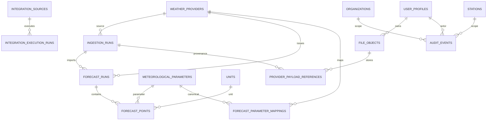

# METRA Weather Intelligence — ERD التفصيلي (مسودة مراجعة)

**الحالة:** مسودة منطقية للمراجعة، وليست DDL ولا تصريحاً بتطبيق SQL  
**الفرع:** `work/database-architecture-fresh-design-2026-11-14`  
**النطاق:** قاعدة جديدة مستقلة تماماً؛ لا استيراد ولا استنساخ من قواعد METRA السابقة.

## 1. قواعد قراءة النموذج

- كل PK من نوع UUID.
- `FK` مفتاح أجنبي، `UQ` تفرد، `CK` تحقق، `NN` إلزامي.
- جميع الأوقات المطلقة `timestamptz`، مع حفظ منطقة IANA عند الحاجة.
- كتالوجات الحالات والبيانات المرجعية تُملأ من مصادر جديدة معتمدة فقط.
- قيم القياسات العلمية وحدودها ودقتها ووحداتها النهائية **TBD** إلى أن يعتمدها مختص الأرصاد.
- لا يحتوي أي جدول على كلمات مرور أو مفاتيح API أو أسرار.

## 2. ERD — الهوية والحوكمة والكتالوج والرصد

```mermaid
erDiagram
  USER_PROFILES ||--o{ MEMBERSHIPS : holds
  ORGANIZATIONS ||--o{ ORGANIZATION_UNITS : contains
  ORGANIZATION_UNITS ||--o{ ORGANIZATION_UNITS : parent_of
  ORGANIZATIONS ||--o{ MEMBERSHIPS : includes
  ORGANIZATIONS ||--o{ STATIONS : owns
  USER_PROFILES ||--o{ REGISTRATION_REQUESTS : requests
  ROLES ||--o{ REGISTRATION_REQUESTS : requested_role
  STATIONS ||--o{ REGISTRATION_REQUESTS : requested_station
  REGISTRATION_REQUESTS ||--o{ REGISTRATION_DECISIONS : decisions
  USER_PROFILES ||--o{ REGISTRATION_DECISIONS : actor
  ROLES ||--o{ ROLE_PERMISSIONS : includes
  PERMISSIONS ||--o{ ROLE_PERMISSIONS : assigned
  MEMBERSHIPS ||--o{ ROLE_ASSIGNMENTS : receives
  ROLES ||--o{ ROLE_ASSIGNMENTS : role
  USER_PROFILES ||--o{ PERMISSION_GRANTS : subject
  PERMISSIONS ||--o{ PERMISSION_GRANTS : delegated
  ROLE_ASSIGNMENTS ||--o{ ACCESS_REVIEWS : reviewed
  PERMISSION_GRANTS ||--o{ ACCESS_REVIEWS : reviewed
  USER_PROFILES ||--o{ ACCESS_REVIEWS : reviewer
  STATION_TYPES ||--o{ STATIONS : classifies
  STATIONS ||--o{ STATION_IDENTIFIERS : identified_by
  STATIONS ||--o{ STATION_LOCATIONS : located_at
  STATIONS ||--o{ STATION_CAPABILITIES : supports
  STATIONS ||--o{ STATION_OPERATING_PERIODS : operates
  STATIONS ||--o{ STATION_REVIEWS : reviewed
  USER_PROFILES ||--o{ STATION_REVIEWS : reviewer
  STATIONS ||--o{ OBSERVATION_SUBMISSIONS : observed_at
  USER_PROFILES ||--o{ OBSERVATION_SUBMISSIONS : submits
  OBSERVATION_TYPES ||--o{ OBSERVATION_SUBMISSIONS : classifies
  OBSERVATION_SUBMISSIONS ||--o{ OBSERVATION_VALUES : contains
  METEOROLOGICAL_PARAMETERS ||--o{ OBSERVATION_VALUES : defines
  UNITS ||--o{ OBSERVATION_VALUES : unit
  OBSERVATION_SUBMISSIONS ||--o{ OBSERVATION_REVISIONS : versioned
  OBSERVATION_SUBMISSIONS ||--o{ OBSERVATION_REVIEW_DECISIONS : decided
  USER_PROFILES ||--o{ OBSERVATION_REVIEW_DECISIONS : reviewer
  OBSERVATION_VALUES ||--o{ OBSERVATION_QUALITY_FLAGS : flagged
  OBSERVATION_SUBMISSIONS ||--o{ OBSERVATION_QUALITY_FLAGS : flagged
  FILE_OBJECTS ||--o{ OBSERVATION_ATTACHMENTS : linked
  OBSERVATION_SUBMISSIONS ||--o{ OBSERVATION_ATTACHMENTS : evidence
```

## 3. ERD — التنبؤات والتكامل والتدقيق

## 4. الكيانات والجداول

### IAM — `iam` (MVP)
| الجدول | الغرض | العلاقات |
|---|---|---|
| user_profiles | ملف التطبيق المرتبط بهوية Auth خارجية | 1:1 auth subject |
| organizations | الجهات المالكة/المشغلة | تملك وحدات ومحطات وعضويات |
| organization_units | هيكل تنظيمي هرمي | جهة + parent اختياري |
| memberships | عضوية مستخدم بجهة ووحدة وحالة وفترة | user + organization + unit |
| roles | قاموس الأدوار | role_permissions وassignments |
| permissions | قاموس الصلاحيات الدقيقة | role_permissions وgrants |
| role_permissions | ربط الدور بالصلاحية | role + permission، UQ pair |
| role_assignments | تعيين دور ضمن نطاق زمني | membership + role + scope |
| permission_grants | تفويض مباشر استثنائي ومحدد المدة | user + permission + grantor + scope |
| access_reviews | مراجعة/تجديد/إلغاء امتياز | reviewer + assignment أو grant |
| registration_requests | طلب انتساب بعد إنشاء هوية Auth | applicant + role + station |
| registration_decisions | سجل قرارات مراحل الانتساب | request + actor + stage |

### Catalog — `catalog` (MVP)
| الجدول | الغرض | العلاقات |
|---|---|---|
| station_types | فئات المحطات | stations |
| stations | الهوية الثابتة للمحطة، مستقلة عن حالة الاعتماد والتشغيل | organization + station_type |
| station_identifiers | رموز خارجية متعددة للمحطة | station |
| station_locations | إحداثيات وارتفاع ومنطقة زمنية ذات تاريخ صلاحية | station |
| station_capabilities | قدرات الرصد وفتراتها | station + capability reference |
| station_operating_periods | تاريخ التشغيل والتوقف | station |
| station_reviews | قرارات اعتماد الكتالوج وأسبابها | station + reviewer |

### Reference — `ref` (MVP)
| الجدول | الغرض | العلاقات |
|---|---|---|
| units | وحدات القياس المعتمدة | parameter definitions, values |
| meteorological_parameters | قاموس البارامترات وإصداراته ووحدته القياسية | units |
| observation_types | أنواع/دوريات نماذج الرصد | submissions |

### Observations — `observations` (MVP)
| الجدول | الغرض | العلاقات |
|---|---|---|
| submissions | غلاف الإرسال: المحطة، المؤلف، الوقت، الحالة، idempotency | station + author + type |
| values | قيم typed للبارامترات | submission + parameter + unit |
| revisions | تاريخ نسخ الرصد غير القابل للمحو | submission |
| review_decisions | قرارات المراجعة وملاحظاتها | submission + reviewer |
| quality_flags | أعلام QC على الإرسال أو القيمة | submission XOR value |
| attachments | ربط أدلة الملفات بالرصد | submission + file object |

### Weather — `weather` (مرحلي)
| الجدول | الغرض | العلاقات |
|---|---|---|
| providers | مزودو بيانات الطقس والتنبؤ | ingestion/forecast |
| ingestion_runs | عمليات جلب/استيراد ونتائجها | provider |
| forecast_runs | دورة إصدار نموذج/تنبؤ | provider + ingestion run |
| forecast_points | قيمة تنبؤ مكانية/زمنية typed | run + parameter + unit |
| forecast_parameter_mappings | ترجمة رموز المزود إلى المعايير | provider + parameter |
| provider_payload_references | مرجع آمن لحمولة خام عند السماح | ingestion + file object |

### Shared infrastructure
| الجدول | الغرض | العلاقات |
|---|---|---|
| files.objects | metadata لملفات Storage فقط | owner + domain link tables |
| integration.sources | سجل مصادر التكامل بلا أسرار | execution_runs |
| integration.execution_runs | نتائج تشغيل التكاملات | source |
| audit.events | سجل تدقيق append-only | actor/scope optional |

## 5. قواعد العلاقات والتعددية

1. الجهة تملك عدة محطات ووحدات وعضويات.
2. المستخدم يملك عدة عضويات؛ الدور الفعلي يأتي من تعيين scoped وفعال زمنياً، وليس من حقل role واحد.
3. الدور والصلاحية علاقة N:M عبر role_permissions مع منع التكرار.
4. تعيين الدور يتبع عضوية واحدة ونطاقاً واحداً واضحاً.
5. المحطة لها معرفات خارجية ومواقع وقدرات وفترات تشغيل متعددة عبر الزمن.
6. إرسال الرصد يتبع محطة ومؤلفاً ونوعاً واحداً، ويحتوي عدة قيم.
7. كل قيمة ترتبط ببارامتر ووحدة معرفين؛ لا قيم علمية غير معرّفة.
8. قرارات المراجعة revisions أحداث تاريخية؛ لا يتم محو قرار سابق.
9. كل forecast point يتبع run ومزوداً ووقت صلاحية وموقعاً/خلية وفق عقد المصدر.
10. ملفات التخزين ترتبط بمراجع صريحة، لا بنصوص حرة.
11. audit لا يحل محل تاريخ المجال.

## 6. القيود الحرجة

- PK وFK لكل العلاقات، مع فهرس لكل FK مستخدم.
- UQ للأكواد والمفاتيح الخارجية ومفاتيح idempotency ضمن نطاقها.
- CHECK لحالات lifecycle والإحداثيات والفترات وتوافق نطاقات الصلاحيات.
- XOR في quality_flags: submission أو value فقط.
- XOR في access_reviews: role_assignment أو permission_grant فقط.
- valid_from < valid_to عند وجود نهاية.
- منع تداخل فترات المواقع/التعيينات حيث يقتضي العقد ذلك.
- فصل approval_status عن operational_status.
- لا تجعل JSONB بديلاً عن typed scientific values.
- RLS وGRANTs وفق نموذج وصول معتمد، وعدم تعريض schemas الداخلية للـ Data API.
- جميع العمليات الحساسة تشتق actor من JWT موثوق وتتحقق من نطاقه.

## 7. قرارات تتطلب اعتماداً

| القرار | الحالة |
|---|---|
| مصدر دليل المحطات الجديد | يحتاج مصدر موثق |
| هيكل الجهات والوحدات | يحتاج اعتماد |
| قائمة الأدوار والصلاحيات | تحتاج مصفوفة نهائية |
| parameters والوحدات والدقة والمدى | TBD — مختص أرصاد |
| نماذج الرصد ودورياتها وتوقيتها | TBD — مختص أرصاد |
| مزود التنبؤ وعقده | يحتاج عقد تكامل |
| PostGIS/partitioning | قرار تنفيذي بعد قياس |
| الاحتفاظ بالملفات والحمولات والتدقيق | يحتاج سياسة حوكمة |

## 8. بوابة الانتقال إلى DDL

لا تنشأ migrations قبل اعتماد ERD والقاموس ومصفوفة الصلاحيات والمواصفات العلمية. يجب أن يكون baseline الاختبار مستقلاً عن سلسلة migrations الحالية في المستودع.
