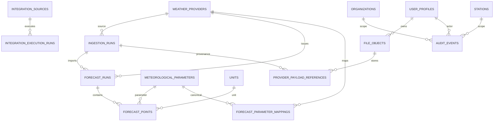

# METRA Weather Intelligence — ERD التفصيلي (مسودة مراجعة)

**الحالة:** مسودة منطقية للمراجعة، وليست DDL ولا تصريحاً بتطبيق SQL  
**الفرع:** `work/database-architecture-fresh-design-2026-11-14`  
**النطاق:** قاعدة جديدة مستقلة تماماً؛ لا استيراد ولا استنساخ من قواعد METRA السابقة.

## 1. قواعد قراءة النموذج

- كل PK من نوع UUID ما لم يذكر خلاف ذلك.
- الرمز `FK` يعني مفتاحاً أجنبياً، و`UQ` قيد تفرد، و`CK` قيد تحقق، و`NN` عدم قبول NULL.
- جميع الأوقات المطلقة `timestamptz`، مع حفظ المنطقة الزمنية IANA للمحطة عند الحاجة.
- جداول `ref` وكتالوجات الحالة لا تُملأ إلا من مصادر جديدة معتمدة. لا توجد بيانات محطات مضمّنة في هذه المسودة.
- قيم القياسات العلمية وحدودها ودقتها ووحداتها النهائية **TBD** إلى أن يعتمدها مختص الأرصاد.
- العلاقات الزمنية (الفترات السارية) تحتاج قيود عدم تداخل؛ يحدد تنفيذها بعد اعتماد PostgreSQL extensions والسياسة الزمنية.
- لا يحتوي أي جدول على كلمات مرور أو مفاتيح API أو مفاتيح service-role.

## 2. مخطط ERD — النطاق الأساسي MVP

```mermaid
erDiagram
  USER_PROFILES ||--o{ MEMBERSHIPS : holds
  ORGANIZATIONS ||--o{ ORGANIZATION_UNITS : contains
  ORGANIZATION_UNITS ||--o{ ORGANIZATION_UNITS : parent_of
  ORGANIZATIONS ||--o{ MEMBERSHIPS : includes
  ORGANIZATIONS ||--o{ STATIONS : owns
  USER_PROFILES ||--o{ REGISTRATION_REQUESTS : requests
  ROLES ||--o{ REGISTRATION_REQUESTS : requested_role
  STATIONS ||--o{ REGISTRATION_REQUESTS : requested_station
  REGISTRATION_REQUESTS ||--o{ REGISTRATION_DECISIONS : reviewed_by
  USER_PROFILES ||--o{ REGISTRATION_DECISIONS : actor
  ROLES ||--o{ ROLE_PERMISSIONS : grants
  PERMISSIONS ||--o{ ROLE_PERMISSIONS : included
  MEMBERSHIPS ||--o{ ROLE_ASSIGNMENTS : receives
  ROLES ||--o{ ROLE_ASSIGNMENTS : assigned
  USER_PROFILES ||--o{ PERMISSION_GRANTS : subject
  PERMISSIONS ||--o{ PERMISSION_GRANTS : delegated
  USER_PROFILES ||--o{ ACCESS_REVIEWS : reviewer
  ROLE_ASSIGNMENTS ||--o{ ACCESS_REVIEWS : reviewed
  PERMISSION_GRANTS ||--o{ ACCESS_REVIEWS : reviewed
  STATION_TYPES ||--o{ STATIONS : classifies
  STATIONS ||--o{ STATION_IDENTIFIERS : identified_by
  STATIONS ||--o{ STATION_LOCATIONS : located_at
  STATIONS ||--o{ STATION_CAPABILITIES : supports
  STATIONS ||--o{ STATION_OPERATING_PERIODS : operates
  STATIONS ||--o{ STATION_REVIEWS : reviewed
  USER_PROFILES ||--o{ STATION_REVIEWS : reviewer
  STATIONS ||--o{ OBSERVATION_SUBMISSIONS : observed_at
  USER_PROFILES ||--o{ OBSERVATION_SUBMISSIONS : submitted_by
  OBSERVATION_TYPES ||--o{ OBSERVATION_SUBMISSIONS : classifies
  OBSERVATION_SUBMISSIONS ||--o{ OBSERVATION_VALUES : contains
  METEOROLOGICAL_PARAMETERS ||--o{ OBSERVATION_VALUES : parameter
  UNITS ||--o{ OBSERVATION_VALUES : reported_unit
  OBSERVATION_SUBMISSIONS ||--o{ OBSERVATION_REVISIONS : versioned
  OBSERVATION_SUBMISSIONS ||--o{ OBSERVATION_REVIEW_DECISIONS : decided
  USER_PROFILES ||--o{ OBSERVATION_REVIEW_DECISIONS : reviewer
  OBSERVATION_VALUES ||--o{ OBSERVATION_QUALITY_FLAGS : flagged
  OBSERVATION_SUBMISSIONS ||--o{ OBSERVATION_QUALITY_FLAGS : submission_flag
  FILE_OBJECTS ||--o{ OBSERVATION_ATTACHMENTS : linked
  OBSERVATION_SUBMISSIONS ||--o{ OBSERVATION_ATTACHMENTS : evidence
```

## 3. مخطط ERD — الطقس والتكامل والتدقيق (مرحلي)

## 4. قاموس الكيانات حسب المجال

### 4.1 الهوية والحوكمة `iam`

| الجدول | الغرض | المفتاح/العلاقات الأساسية |
|---|---|---|
| `user_profiles` | ملف التطبيق المرتبط بهوية مزود المصادقة | PK id؛ 1:1 مع auth subject الخارجي |
| `organizations` | الجهة المالكة/المشغلة | PK id |
| `organization_units` | وحدات إدارية متداخلة داخل الجهة | FK organization؛ FK parent اختياري |
| `memberships` | عضوية مستخدم في جهة وحالتها وفترتها | FK user + organization |
| `roles` | تعريف الأدوار المعتمدة | UQ code |
| `permissions` | قاموس الصلاحيات الدقيقة | UQ code |
| `role_permissions` | ربط الدور بالصلاحية | FK role + permission؛ UQ pair |
| `role_assignments` | تعيين دور إلى عضوية ضمن نطاق زمني | FK membership + role؛ scope |
| `permission_grants` | تفويض مباشر استثنائي محدد المدة والنطاق | FK subject + permission + grantor |
| `access_reviews` | مراجعة دور/تفويض مميز وتجديده أو إلغاؤه | FK reviewer؛ مرجع واحد إلى assignment أو grant |
| `registration_requests` | طلب انتساب بعد إنشاء هوية المصادقة | FK applicant + requested role + requested station |
| `registration_decisions` | مراحل قرار طلب الانتساب وسجلها غير القابل للاستبدال | FK request + actor؛ stage |

### 4.2 دليل المحطات `catalog`

| الجدول | الغرض | المفتاح/العلاقات الأساسية |
|---|---|---|
| `station_types` | فئات المحطات المضبوطة | UQ code |
| `stations` | الهوية الثابتة للمحطة | FK organization + station_type؛ UQ local code داخل الجهة |
| `station_identifiers` | رموز المحطة في مصادر مستقلة | FK station؛ UQ source + identifier |
| `station_locations` | تاريخ الإحداثيات والارتفاع والمنطقة الزمنية والتحقق | FK station؛ فترات صلاحية |
| `station_capabilities` | قدرات الرصد المدعومة وفتراتها | FK station + parameter/capability reference |
| `station_operating_periods` | فترات التشغيل والتوقف | FK station؛ interval |
| `station_reviews` | قرارات اعتماد سجل المحطة | FK station + reviewer؛ سجل تاريخي |

### 4.3 قاموس الأرصاد `ref`

| الجدول | الغرض | المفتاح/العلاقات الأساسية |
|---|---|---|
| `units` | وحدات القياس المعتمدة وتعريف التحويل | UQ code؛ التحويلات المعقدة TBD |
| `meteorological_parameters` | تعريف البارامترات العلمية وإصداراتها | UQ code + version؛ FK canonical unit |
| `observation_types` | أنواع/دوريات نماذج الرصد | UQ code |

### 4.4 الرصد اليدوي والمراجعة `observations`

| الجدول | الغرض | المفتاح/العلاقات الأساسية |
|---|---|---|
| `submissions` | غلاف إرسال الرصد وحالته ومصدره ومفتاح منع التكرار | FK station + author + observation type |
| `values` | قيمة واحدة typed لبارامتر محدد ضمن إرسال | FK submission + parameter + unit |
| `revisions` | لقطات إصدار غير قابلة للتعديل للرصد | FK submission؛ UQ submission + revision number |
| `review_decisions` | قرارات الإرسال/الإرجاع/الاعتماد/الرفض | FK submission + reviewer |
| `quality_flags` | نتائج قواعد الجودة وإصداراتها | FK submission أو value؛ أحدهما فقط |
| `attachments` | ربط أدلة الملفات بالرصد | FK submission + file object |

### 4.5 التنبؤات الخارجية `weather` (مرحلي)

| الجدول | الغرض | المفتاح/العلاقات الأساسية |
|---|---|---|
| `providers` | سجل مزودي التنبؤ ومراجع المنتجات | UQ code |
| `ingestion_runs` | عملية جلب/استيراد واحدة ونتيجتها | FK provider؛ correlation/idempotency |
| `forecast_runs` | دورة إصدار نموذج/تنبؤ من مزود | FK provider + ingestion run |
| `forecast_points` | قيمة تنبؤ مكانية/زمنية typed | FK run + parameter + unit |
| `forecast_parameter_mappings` | ترجمة معرّف مزود إلى بارامتر معياري | FK provider + parameter |
| `provider_payload_references` | مرجع آمن ومقيد لحمولة المزود الخام | FK ingestion run + file object |

### 4.6 الملفات والتكامل والتدقيق

| الجدول | الغرض | المفتاح/العلاقات الأساسية |
|---|---|---|
| `files.objects` | بيانات وصفية لملفات التخزين فقط | PK id؛ UQ bucket + object key |
| `integration.sources` | تعريف موصل/مصدر خارجي بلا أسرار | UQ code |
| `integration.execution_runs` | تشغيل تكامل مستقل عن جلب الطقس عند الحاجة | FK source |
| `audit.events` | سجل أحداث أمني وتجاري append-only | actor اختياري + scope اختياري |

## 5. قواعد العلاقات والتعددية

1. الجهة الواحدة تملك صفراً أو أكثر من المحطات والعضويات والوحدات.
2. المستخدم قد يمتلك عضويات متعددة، لكن لا يُمنح دوراً خارج عضوية صالحة إلا بتفويض مباشر صريح.
3. الدور يضم عدة صلاحيات، والصلاحية قد تظهر في عدة أدوار؛ جدول الربط يمنع التكرار.
4. تعيين الدور مرتبط بعضوية واحدة ونطاق واحد واضح؛ لا يسمح بنطاق station دون station_id، ولا بنطاق organization دون organization_id.
5. المحطة لها هويات خارجية متعددة ومواقع وقدرات وفترات تشغيل متعددة عبر الزمن.
6. لا يسمح بتداخل فترات الموقع المعتمدة للمحطة نفسها إلا إذا أقر المجال أكثر من موضع متزامن (TBD).
7. إرسال الرصد يتبع محطة واحدة ومؤلفاً واحداً ونوع رصد واحداً، ويحتوي قيماً متعددة.
8. قرار المراجعة سجل جديد؛ لا يتم تحديث قرار سابق لمحو أثره. تصحيح البيانات ينشئ revision جديدة.
9. كل قيمة رصد تشير إلى parameter وunit محددين. لا تُقبل قيمة بلا تعريف علمي معتمد.
10. كل نقطة تنبؤ تتبع forecast run واحداً ووقت صلاحية وموقعاً/خلية مكانية وفق عقد المزود.
11. ملفات التخزين لا ترتبط بكيان عبر نص حر؛ روابطها عبر جداول وصل محددة.
12. أحداث التدقيق لا تُستخدم بديلاً عن جداول تاريخ المجال.

## 6. ضوابط على مستوى قاعدة البيانات

- PK على كل جدول تشغيلي، FK لكل علاقة موضحة، وفهارس على جميع مفاتيح FK المستخدمة في الاستعلامات.
- UQ على الأكواد الثابتة، ومفاتيح المصدر الخارجية، ومفاتيح idempotency ضمن نطاقها.
- CHECK لحالات lifecycle، القيم الموجبة للأحجام، سلامة الإحداثيات، واتساق حقول النطاق.
- CHECK XOR في `quality_flags`: إما observation_value_id أو submission_id، وليس كليهما أو لا شيء.
- CHECK XOR في `access_reviews`: إما role_assignment_id أو permission_grant_id.
- CHECK على الفترات: `valid_from < valid_to` عند وجود نهاية.
- لا تُخزن الحالة التشغيلية للمحطة في حقل اعتماد الكتالوج؛ لكل مفهوم حالة مستقلة.
- لا تُخزن قيم الطقس أو الرصد في JSONB بوصفه المصدر القانوني؛ JSONB مقتصر على metadata مصدرية مسموحة.
- RLS وGRANTs حسب نموذج وصول مُراجع؛ لا يُفتح أي schema داخلي للـ Data API افتراضياً.
- كل وظيفة ذات امتياز تتحقق من هوية المنفذ ونطاقه في الخادم/المعاملة، ولا تثق بمعرّف actor القادم من العميل.

## 7. قرارات لا يجوز تحويلها إلى قيود نهائية قبل اعتمادها

| القرار | الحالة |
|---|---|
| دليل المحطات الجديد ومصدر كل سجل | يحتاج مصدر معتمد |
| أسماء الجهات والوحدات الهرمية | يحتاج قرار مالك المنتج |
| قاموس الأدوار والصلاحيات النهائي | يحتاج مصفوفة اعتماد |
| قائمة parameters والوحدات والدقة والمدى العلمي | TBD — اعتماد مختص أرصاد |
| نماذج الرصد ودورياتها وتوقيتاتها | TBD — اعتماد مختص أرصاد |
| آلية تمثيل المواقع (نقطة/خلية/هندسة) | حسب احتياج المنتج ومزود البيانات |
| PostGIS والتقسيم partitioning | قرار تنفيذي بعد قياس الاستخدام |
| مدة الاحتفاظ بالرصد والحمولات والملفات وسجل التدقيق | قرار حوكمة وخصوصية |
| نطاق forecast ingestion ومزودوه | عقد تكامل ومفاتيح معتمدة |
| نطاق alerts/climate/AI | خارج MVP حتى اعتماد العقود العلمية |

## 8. بوابة الانتقال إلى DDL

لا يبدأ إنشاء migrations إلا بعد:
1. اعتماد هذا الـ ERD أو إرجاع ملاحظات محددة.
2. اعتماد قاموس البيانات والحقول الإلزامية والاختيارية.
3. اعتماد قاموس parameters والوحدات ونماذج الرصد من مختص.
4. اعتماد مصفوفة الصلاحيات ونطاقات الجهات والمحطات.
5. تحديد آلية فصل baseline الاختبار عن migrations الحالية المستخدمة في التطبيق.
