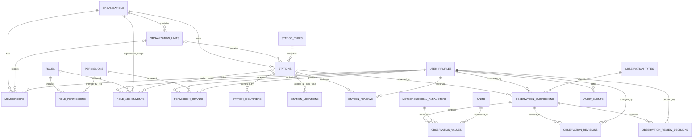

# METRA Weather Intelligence — Detailed Logical ERD

**Status:** Draft for domain/security review — not approved for DDL  
**Branch:** `work/database-architecture-fresh-design-2026-11-14`  
**Scope:** Greenfield database for the new METRA application. No legacy schema or rows are used.  
**Implementation boundary:** Flutter client → trusted .NET API → PostgreSQL. Supabase Auth may provide identity; the database stores only the immutable external subject reference, never passwords.

## 1. Modeling rules

1. UUID primary keys for application entities; natural codes are alternate keys only.
2. All instants use `timestamptz`; station timezone is an IANA name and is not inferred from coordinates.
3. Approval, operational state, account state, and coordinate verification are independent dimensions.
4. Historical decisions and revisions are append-only business records.
5. Meteorological values are typed and linked to controlled parameter/unit definitions. No scientific ranges, precision, formulas, or codes are invented here.
6. Provider forecasts are not station observations. Their ownership, provenance, and lifecycle are separate.
7. The .NET API is the trusted transaction and authorization boundary. Flutter never receives privileged database credentials.
8. Schemas `private` and `audit` are not exposed through the Supabase Data API. Exposed schemas require reviewed grants and RLS policies.
9. All entities below are proposals. “MVP” means supported by currently inspected application workflows; “Future” means intentionally deferred.

## 2. ERD — MVP logical model

> Mermaid ERD shows entity cardinality only. The full column-level contract and exact keys are in [DATA-DICTIONARY.md](DATA-DICTIONARY.md).

## 3. Entity inventory and lifecycle

| Schema | Entity | Phase | Purpose / lifecycle |
|---|---|---|---|
| iam | user_profiles | MVP | One app profile per external Auth subject; pending/active/blocked lifecycle |
| iam | organizations | MVP | Owning meteorological authority or operating organization |
| iam | organization_units | MVP | Optional hierarchical departments/regions |
| iam | memberships | MVP | User ↔ organization membership and approval lifecycle |
| iam | roles | MVP | Controlled role catalogue; no single role column on user |
| iam | permissions | MVP | Canonical permission codes |
| iam | role_permissions | MVP | Role-to-permission allow-list |
| iam | role_assignments | MVP | Time-bounded global/org/station role assignment |
| iam | permission_grants | MVP | Exceptional time-bounded direct permission delegation |
| catalog | station_types | MVP | Controlled station classes; exact catalogue requires owner approval |
| catalog | stations | MVP | Stable station identity and independent approval/operational states |
| catalog | station_identifiers | MVP | External identifiers with namespace/source |
| catalog | station_locations | MVP | Versioned coordinates and verification provenance |
| catalog | station_reviews | MVP | Append-only approve/reject/request-changes decisions |
| ref | units | MVP foundation | Controlled measurement units; conversion contracts to be approved |
| ref | meteorological_parameters | MVP foundation | Parameter definitions; scientific metadata is approval-gated |
| observations | observation_types | MVP | Controlled daily/hourly/phenomenon/etc. form types; exact set to approve |
| observations | submissions | MVP | Draft → submitted → approved/returned/rejected lifecycle |
| observations | values | MVP | Typed value rows tied to parameter, unit and observation time |
| observations | revisions | MVP | Immutable revision snapshots and actor/reason |
| observations | review_decisions | MVP | Immutable review/approval/return decisions |
| audit | events | MVP | Append-only security and administrative audit trail |
| weather | providers | Future / adapter-ready | External forecast provider registry |
| weather | ingestion_runs | Future | Provider request/import execution history |
| weather | forecast_runs | Future | Provider forecast issue/run envelope |
| weather | forecast_points | Future | Forecast location and valid-time points |
| weather | forecast_values | Future | Typed forecast parameter values |
| alerts | warning_products, warning_areas | Future | Official warning products after provider contract |
| climate | datasets, analysis_jobs, results | Future | Climate analytics after scientific method approval |
| files | objects | Deferred | Controlled metadata for private object storage, if attachments become required |

## 4. Relationship contracts and cardinality

### IAM
- `organizations 1 — 0..N organization_units`; each unit belongs to exactly one organization; `parent_unit_id` is optional and must point within the same organization.
- `organizations 1 — 0..N memberships`; `user_profiles 1 — 0..N memberships`. Enforce one current membership per (user, organization) with a partial unique index only after the rejoin/history policy is approved.
- `roles N — N permissions` through `role_permissions`; pair unique.
- `user_profiles 1 — 0..N role_assignments`; each assignment references one role and exactly one scope: global, organization, or station. A CHECK constraint enforces scope-column consistency.
- `permission_grants` references one subject, one permission, one grantor, and exactly one scope. Grantor must be authorized by the API; prevent self-grant unless explicitly approved by policy.
- Role and permission codes are immutable identifiers; display names may be localized.

### Station catalogue
- `organizations 1 — 0..N stations`; optional `organization_units` may be the operating unit.
- `stations 1 — 0..N station_identifiers`; identifier namespace + normalized value + source uniqueness policy must be approved.
- `stations 1 — 0..N station_locations`; records are temporal versions, not overwrites. At most one current valid location per station.
- `stations 1 — 0..N station_reviews`; every decision stores reviewer, prior/result state, reason and decision time.
- Station approval status, operational status and coordinate verification are independent. Do not collapse them into one status.

### Observations
- `stations 1 — 0..N observation_submissions`; each submission has one author and one observation type.
- `observation_submissions 1 — 0..N observation_values`; each value identifies one parameter and one unit.
- `observation_submissions 1 — 0..N observation_revisions`; revision sequence unique per submission. Current state is derived from the latest accepted revision or maintained through a transactionally guarded pointer.
- `observation_submissions 1 — 0..N observation_review_decisions`; decisions are immutable and preserve reviewer identity. Approval must enforce separation-of-duties if required by policy.
- Idempotency is enforced by a unique key scoped to the authenticated author (not by trusting a client-provided actor ID).
- The observation envelope stores event/observation time and source context. Each value may carry a distinct measurement time only if the scientific form requires it.

### Weather and future domains
- A provider has many ingestion runs; an ingestion run may create zero or more forecast runs.
- A forecast run has many forecast points; each point has many forecast values.
- Forecast valid time and provider issue time are separate. Provider payloads are provenance, not canonical typed measurements.
- Alerts and climate analysis remain out of MVP ERD until source contracts, scientific semantics, retention and authorization are approved.

## 5. Important constraints (logical; exact SQL deferred)

| Entity | Constraint |
|---|---|
| user_profiles | Unique external Auth subject; no password or secret columns |
| memberships | FK to profile + organization; validity interval must be positive; lifecycle constrained |
| role_permissions | Unique (role_id, permission_id) |
| role_assignments | Exactly one scope target consistent with scope_type; valid_from < valid_to when valid_to exists |
| permission_grants | Exactly one scope target; valid time interval; grantor and subject are distinct by default |
| stations | Unique approved local station code within its owning authority; station type FK; independent constrained statuses |
| station_identifiers | Namespace and normalized identifier unique according to source ownership contract |
| station_locations | Latitude/longitude domain checks; valid_from < valid_to; non-overlapping effective intervals per station; at most one current row |
| station_reviews | Decision in approved/rejected/changes_requested; reason required; append-only |
| observation_submissions | Idempotency key unique per author; lifecycle constrained; station must be eligible at submission according to server policy |
| observation_values | Exactly one typed value column populated according to parameter value_kind; FK parameter + unit; finite numeric values |
| observation_revisions | Unique (submission_id, revision_no); immutable revision content |
| observation_review_decisions | Decision enum; required reason for return/reject; immutable; reviewer cannot be author where separation is required |
| audit.events | Append-only; actor may be system; no secrets/tokens/raw credentials in payload |
| all temporal entities | `valid_from < valid_to`; use half-open intervals [from,to) to avoid boundary overlap |

## 6. Security and database boundary

- Keep domain tables outside `public` unless a reviewed Data API exposure is explicitly required.
- Revoke direct table access from `anon` and ordinary `authenticated` clients by default.
- If a table is exposed, enable RLS and define operation-specific policies with row ownership/resource scope checks. Authentication alone is not authorization.
- Do not use user-editable Auth metadata for authorization.
- Server runtime must use a dedicated least-privilege database role. Avoid broad service-role use outside trusted server execution.
- Avoid `SECURITY DEFINER` unless a documented threat-model exception exists; if needed, place it in `private`, pin search_path, restrict EXECUTE, and test authorization.
- Audit actor and timestamps are derived by trusted server/database context, not accepted from Flutter request bodies.
- Storage object paths are opaque references; private buckets and policies are separate from metadata.
- Retention, deletion, anonymization, backup and data-residency policy are mandatory review items before production.

## 7. Decisions required before physical DDL

1. Official organization hierarchy and the initial authority/organization owner.
2. New station catalogue source, namespace rules, station code uniqueness, station types and approval owner.
3. Exact requestable roles, permission catalogue, scope model and two-stage review separation.
4. Exact observation forms and cadence; parameter list, quantity kinds, units, precision, ranges, formulas and QC rules from an approved scientific specification.
5. Whether each observation value has its own timestamp or inherits the submission observation time.
6. Whether a phenomenon report is text-only, typed coded phenomena, or both.
7. Retention and legal basis for identity, phone number, observation, audit and attachment data.
8. Whether forecast provider ingestion is in the first release; provider terms, fields, coordinates and attribution.
9. Whether the .NET API is the only application database writer, and whether Supabase Edge Functions remain transitional adapters.
10. PostgreSQL/PostGIS version and spatial query requirements.

## 8. Review gate

No SQL migration is generated or applied by this draft. Once the ERD and data dictionary are approved, the next phase will create a fresh ordered migration set and a disposable empty-database rebuild test. No hosted Supabase project is touched by that local verification.

## 9. Migration isolation note

The repository already contains an earlier `supabase/migrations` chain for the currently implemented application. That chain is not the approved greenfield baseline and must not be replayed or extended as if it were an empty-database rebuild. After this ERD and dictionary are approved, the clean migration chain must be isolated (dedicated Supabase CLI project/configuration and explicit target) and verified against a disposable empty PostgreSQL instance. Existing hosted projects and their migration history remain untouched unless the owner separately authorizes a deployment.
